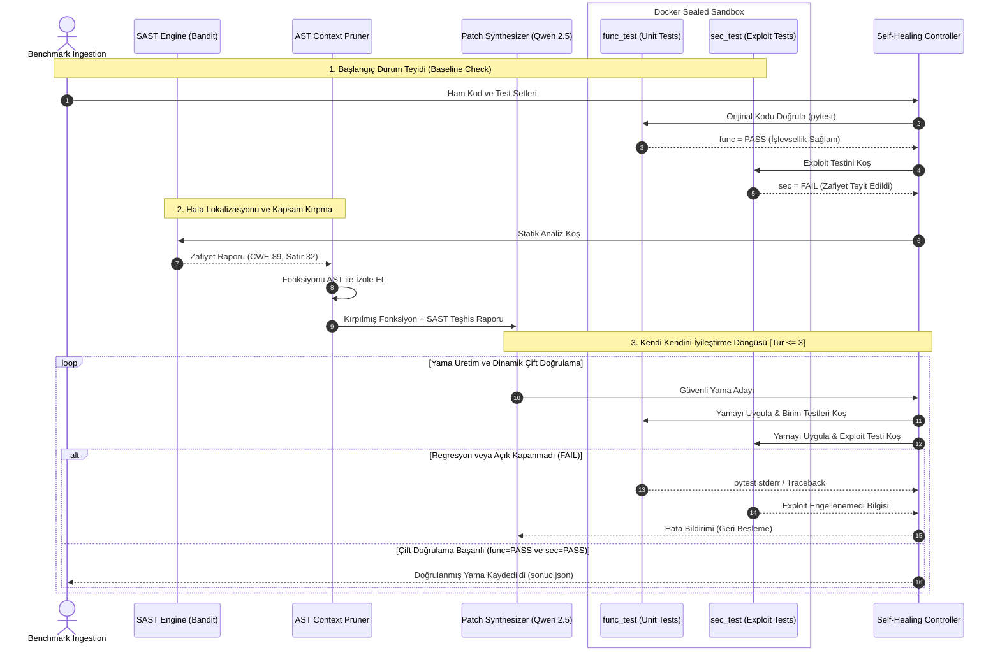

# 🛡️ Autonomous Vulnerability Repair Pipeline (AVR)

> **Deterministik Araçlarla (SAST + Pytest) Desteklenmiş, Otonom ve Doğrulanabilir LLM Güvenlik Yamalama Motoru**

[](https://www.python.org/)
[](https://ollama.com/library/qwen2.5-coder)
[](https://bandit.readthedocs.io/)
[](https://www.docker.com/)
[](https://docs.pytest.org/)

---

## 📌 Proje Özeti

Günümüz kod üretim ajanları (*vibe coding*), karmaşık fonksiyonel gereksinimleri başarıyla üretse de yüksek oranda kritik güvenlik açıkları (CWE) barındırabilmektedir. 

Bu projenin temel amacı; **güvenlik açıklarını onarırken sistemin orijinal işlevini bozmayan (sıfır regresyon), deterministik araçlarla desteklenmiş, otonom ve çift-doğrulamalı (dual-verification) bir LLM program onarım motoru** sunmaktır.

### Temel Prensipler:
1. **Hedefe Yönelik Teşhis (Fault Localization):** Kod bütünüyle modele verilmez. SAST (Bandit) zafiyetin satırını ve CWE türünü teşhis eder.
2. **Kapsam Kırpma (AST Pruning):** Python `ast` modülü ile sadece zafiyetli fonksiyon izole edilir; token maliyeti ve halüsinasyon riski minimize edilir.
3. **Çift Doğrulama (Dual-Verification):** Üretilen yama Docker içinde hem birim testlerle (`func_test.py`) hem de exploit testleriyle (`sec_test.py`) sınanır.
4. **Kendi Kendini İyileştirme (Self-Healing Loop):** Bir test patlarsa, konteynerden dönen hata traceback'i cerrahi bir geri bildirim olarak modele aktarılır ve yama yenilenir.

---

## 🏗️ Mimari ve İş Akışı

Aşağıdaki iş akışı diyagramı, zafiyetli kodun sisteme girmesinden doğrulanmış yamanın üretilmesine kadar olan adımları göstermektedir:



---

## 📂 Dizin Yapısı

```text
bitirme/
├── pipeline/
│   ├── sample_task/           # Örnek zafiyetli görev ortamı
│   │   ├── app.py             # Zafiyetli kaynak kod (örn. CWE-89 SQLi)
│   │   ├── func_test.py       # Fonksiyonel regresyon testleri
│   │   ├── sec_test.py        # Exploit / Güvenlik testleri
│   │   └── sonuc.json         # Doğrulanmış yama raporu
│   ├── sast/
│   │   └── sast_engine.py     # Bandit SAST çalıştırıcı ve JSON parser
│   ├── pruner/
│   │   └── ast_pruner.py      # Python AST tabanlı cerrahi fonksiyon kesici
│   ├── synthesizer/
│   │   └── synthesizer.py     # Yerel Ollama Qwen2.5-Coder yama motoru
│   ├── sandbox/
│   │   ├── Dockerfile         # İzole Linux test sandbox imajı
│   │   └── docker_runner.py   # Docker volume ve pytest yöneticisi
│   └── controller.py          # Uçtan uca self-healing orkestratörü
├── UML/                       # PlantUML kaynakları ve mimari şemaları
├── .gitignore
└── README.md
```

---

## ⚡ Hızlı Başlangıç (Windows & macOS)

### Gereksinimler
1. **Python 3.11 – 3.13** *(Semgrep ve PyTorch/Transformers uyumu için 3.13 önerilir)*
2. **Docker Desktop** (Engine çalışır durumda olmalıdır; hem `amd64` hem Apple Silicon `arm64` desteklenir)
3. **Ollama** (varsayılan `ollama` arka ucu için `qwen2.5-coder:7b` modeli indirilmiş olmalıdır):
   ```bash
   ollama pull qwen2.5-coder:7b
   ```

### Kurulum ve Çalıştırma

1. **Sanal Ortam ve Bağımlılıkları Kurun:**
   ```bash
   # macOS / Linux
   python3.13 -m venv .venv && source .venv/bin/activate
   pip install -r requirements.txt

   # Windows (PowerShell)
   python -m venv .venv
   .\.venv\Scripts\Activate.ps1
   pip install -r requirements.txt
   ```
   *(İleride Hugging Face `transformers` arka ucu için ayrıca `pip install -r requirements-transformers.txt` kurulur.)*

2. **Docker Sealed Sandbox İmajını Derleyin:**
   ```bash
   docker build -t bitirme-sandbox pipeline/sandbox
   ```

3. **Pipeline'ı Çalıştırın:**
   ```bash
   # Tek görev üzerinde çalıştırma
   python -m pipeline.controller pipeline/sample_task

   # Kontrollü Mikro-Kıyaslama (4 Görev)
   python -m pipeline.run_all

   # SusVibes veri kümesinden uygun görevleri listeleme
   python -m pipeline.run_all --list-susvibes CWE-22

   # Birim & bütünlük testlerini çalıştırma
   pytest
   ```

---

## 📊 Örnek Canlı Terminal Çıktısı

Pipeline çalıştığında tüm fazlar deterministik olarak doğrulanır ve raporlanır:

```text
======================================================================
🚀 OTONOM VE DOĞRULANABİLİR GÜVENLİK YAMA MOTORU BAŞLATILIYOR
======================================================================

[FAZ 1] Başlangıç Durum Doğrulaması (Baseline Check)...
  ├─ Birim Testler (func_test) : [PASS]
  └─ Exploit Testi (sec_test)  : [FAIL - Zafiyet Doğrulandı]

[FAZ 2] Statik Güvenlik Analizi ve Kapsam Kırpma...
  ├─ Tespit Edilen Zafiyet: CWE-89 (B608)
  ├─ Teşhis               : Possible SQL injection vector through string-based query construction.
  └─ Hedef Satır          : 32
  [*] AST Kapsamı Kırpıldı: 'get_user_by_username' (25 - 34. satırlar)

[FAZ 3] Kendi Kendini İyileştirme Döngüsü Başlatılıyor (Maks 3 Tur)...

---> [TUR 1/3] <---
  [*] Qwen modeline prompt iletiliyor (Ollama / qwen2.5-coder:7b)...
  [*] Yama üretildi (5.63 saniye).
  [*] Yama kaynak dosyaya uygulanıyor...
  [*] Docker Sealed Sandbox içinde Çift Doğrulama (Pytest) çalıştırılıyor...
  ├─ func_test (Orijinal İşlev) : PASS ✅
  └─ sec_test (Zafiyet Kapatma): PASS ✅

**********************************************************************
🎯 [BAŞARI] ÇİFT DOĞRULAMA GEÇİLDİ! KOD HEM GÜVENLİ HEM DE İŞLEVSEL.
**********************************************************************

[Rapor] Sonuç dosyası kaydedildi: pipeline\sample_task\sonuc.json
```

---

## 🔮 Gelecek Planı (2. Dönem Yol Haritası)
- [x] Çekirdek SAST + AST + LLM + Docker mimarisinin prototipinin tamamlanması.
- [ ] **SusVibes Benchmark Entegrasyonu:** `susvibes_dataset.jsonl` üzerindeki 186 görevin otomatik yüklenip değerlendirilmesi.
- [ ] Semgrep kural setleri ile mantıksal zafiyetlerin kapsama alanının genişletilmesi.
- [ ] Yama kalitesi ve regresyon oranlarının sayısal metriklerle raporlanması.
