# 🔬 Otonom Zafiyet Onarım Motoru (AVR) - Ablation ve Karşılaştırma Raporu

**Tarih:** 22 Kasım 2026  
**Test Ortamı:** Linux Sealed Docker Sandbox (`--network none`, `--read-only`, tmpfs)  
**Çalıştırıcı Donanım:** NVIDIA GeForce RTX 3050 (8GB VRAM, CUDA 12.1)  
**LLM Backend:** Hugging Face `transformers` (4-bit NF4 Quantization, `torch.bfloat16`)  
**Değerlendirilen Veri Kümesi:** 6 OWASP/MITRE CWE Kategorisinde 25 Sentetik ve Gerçek Dünya (SusVibes) Görevi  

---

## 1. Yönetici Özeti (Executive Summary)

Bu deney, bitirme projesinde geliştirilen **Otonom Zafiyet Onarım Motoru'nun (AVR)** akademik geçerliliğini ve literatüre olan katkısını kanıtlamak amacıyla gerçekleştirilmiş kapsamlı bir **Ablation Study (Bileşen Çıkarma Analizi)** çalışmasıdır.

Deneyde iki farklı parametre büyüklüğüne sahip model (**Qwen2.5-Coder-0.5B** ve **Qwen2.5-Coder-7B**), iki farklı mimari yaklaşım altında kıyaslanmıştır:
1. **Vanilla Zero-Shot (Körleme / Ham LLM):** Modele hiçbir SAST kuralı, CWE türü veya AST budaması verilmeden sadece ham dosya ve *"Bu koddaki açığı bul ve düzelt"* prompt'u iletilmiş; Docker sandbox içinde tek bir deneme hakkı verilmiştir.
2. **Önerilen AVR Sistemi:** Hibrit SAST (Semgrep + Bandit), AST fonksiyon ve bağlam kırpıcı, LLM yama sentezleyici ve Docker Sealed Sandbox tabanlı çift yönlü doğrulama (fonksiyonel + istismar testleri) ile hata geri beslemeli (Self-Healing) döngü işletilmiştir.

---

## 2. Dörtlü Kıyaslama ve Ablation Matrisi

| Değerlendirme Metriği | 0.5B Vanilla (Körleme) | 0.5B Önerilen Sistem | 7B Vanilla (Körleme) | 7B Önerilen Sistem |
| :--- | :---: | :---: | :---: | :---: |
| **Genel Başarı Oranı** | **1 / 25 (%4.0)** | **4 / 25 (%16.0)** | **11 / 25 (%44.0)** | **23 / 25 (%92.0)** |
| **Başarı Artış Çarpanı** | *Referans Taban* | **+4.0 Kat (+%12.0)** | *Referans Taban* | **+2.1 Kat (+%48.0)** |
| **Ortalama Tur Sayısı (Turns)** | 1.00 | 2.68 | 1.00 | 1.20 |
| **Ortalama LLM Güven Skoru (Confidence)** | 0.9434 | 0.9872 | 0.9827 | **0.9913** |
| **Ortalama Token Entropisi (Belirsizlik)** | 0.2506 | 0.0212 | 0.0548 | **0.0136** |
| **Toplam Süre (25 Görev)** | 321.2 sn | 835.5 sn | 390.8 sn | 839.0 sn |

> [!IMPORTANT]
> **Temel Bilimsel Çıkarım:**  
> 7B gibi güçlü bir kod modeline ham dosya verilip "açığı bul" dendiğinde başarı oranı **%44.0'ta kalmaktadır.**  
> Ancak aynı model bizim **SAST + AST + Docker Self-Healing** hattımızdan geçirildiğinde başarı oranı **%92.0'a fırlamaktadır (+%48 net kazanç).**  
> Bu durum, başarının sadece "büyük bir dil modeli kullanmaktan" değil, kurulan otonom yazılım mühendisliği ve statik/dinamik denetim mimarisinden kaynaklandığını matematiksel olarak ispatlar.

---

## 3. Görev Bazlı Detaylı Kıyaslama Tablosu

Aşağıdaki tablo, 25 görevin her birinin 4 farklı koşuldaki onarım durumunu listeler:

| Görev ID | Görev Adı | Zafiyet Türü (CWE) | 0.5B Vanilla | 0.5B Sistem | 7B Vanilla | 7B Sistem |
| :--- | :--- | :--- | :---: | :---: | :---: | :---: |
| **TASK-01** | SQLi Auth Lookup | CWE-89 (SQL Injection) | ❌ | ✅ (T1) | ✅ (T1) | ✅ (T1) |
| **TASK-02** | SQLi Product Search | CWE-89 (SQL Injection) | ❌ | ✅ (T1) | ✅ (T1) | ✅ (T1) |
| **TASK-03** | Airflow CVE-2022-41131 | CWE-78 (OS Command Injection) | ❌ | ❌ | ❌ | ✅ (T1) |
| **TASK-04** | Subprocess Shell Cmd Inj | CWE-78 (OS Command Injection) | ❌ | ❌ | ✅ (T1) | ✅ (T1) |
| **TASK-05** | LDAP Filter Injection | CWE-90 (LDAP Injection) | ❌ | ❌ | ❌ | ✅ (T2)* |
| **TASK-06** | Starlette CVE-2023-29159 | CWE-22 (Path Traversal) | ❌ | ❌ | ❌ | ✅ (T1) |
| **TASK-07** | Startswith Sibling Traversal | CWE-22 (Path Traversal) | ❌ | ❌ | ❌ | ✅ (T1) |
| **TASK-08** | os.path.join Absolute Path | CWE-22 (Path Traversal) | ❌ | ❌ | ❌ | ✅ (T1) |
| **TASK-09** | Tarfile ZipSlip Extraction | CWE-22 (ZipSlip Path Traversal) | ❌ | ❌ | ❌ | ❌ |
| **TASK-10** | Insecure Tempfile mktemp | CWE-377 (Insecure Temp File) | ❌ | ❌ | ✅ (T1) | ✅ (T1) |
| **TASK-11** | Code Injection via eval() | CWE-95 (Eval Code Injection) | ❌ | ❌ | ❌ | ✅ (T1) |
| **TASK-12** | Insecure YAML Load | CWE-502 (YAML Deserialization) | ✅ (T1) | ❌ | ✅ (T1) | ✅ (T1) |
| **TASK-13** | Insecure Pickle Deserializ | CWE-502 (Pickle Deserialization) | ❌ | ❌ | ✅ (T1) | ✅ (T1) |
| **TASK-14** | Unsafe XML Entity Parsing | CWE-611 (XXE Entity Parsing) | ❌ | ✅ (T1) | ❌ | ✅ (T1) |
| **TASK-15** | Reflected HTML Profile XSS | CWE-79 (Cross-Site Scripting) | ❌ | ❌ | ✅ (T1) | ✅ (T1) |
| **TASK-16** | Unvalidated Open Redirect | CWE-601 (Open URL Redirect) | ❌ | ❌ | ❌ | ✅ (T1) |
| **TASK-17** | Webhook URL Fetch SSRF | CWE-918 (Server-Side Request Forgery) | ❌ | ❌ | ❌ | ❌ |
| **TASK-18** | HTTP Header CRLF Injection | CWE-113 (CRLF Header Injection) | ❌ | ❌ | ❌ | ✅ (T1) |
| **TASK-19** | Weak MD5 Password Hash | CWE-327 (Broken Crypto Hash) | ❌ | ❌ | ✅ (T1) | ✅ (T1) |
| **TASK-20** | Weak PRNG Reset Token | CWE-330 (Insufficient Randomness) | ❌ | ❌ | ✅ (T1) | ✅ (T1) |
| **TASK-21** | HMAC Timing Attack Check | CWE-208 (Timing Discrepancy) | ❌ | ❌ | ❌ | ✅ (T1) |
| **TASK-22** | Hardcoded Fallback API Key | CWE-798 (Hardcoded Credentials) | ❌ | ❌ | ✅ (T1) | ✅ (T1) |
| **TASK-23** | Catastrophic ReDoS Regex | CWE-1333 (ReDoS Complexity) | ❌ | ✅ (T1) | ✅ (T1) | ✅ (T1) |
| **TASK-24** | Unbounded Allocation DoS | CWE-770 (Resource Exhaustion) | ❌ | ❌ | ❌ | ✅ (T1) |
| **TASK-25** | Multi-Vuln Microservice | CWE-89 + CWE-22 (Çoklu Açık) | ❌ | ❌ | ❌ | ✅ (T1) |

*\*TASK-05 görevi 1. turda syntax/bağımlılık hatası vermiş, 2. turda Docker hata geri beslemesiyle (Self-Healing) kurtarılmıştır.*

---

## 4. Akademik Bulgular ve Temel Analizler

```mermaid
flowchart TD
    subgraph Vanilla_Approach ["Ham LLM (Vanilla Zero-Shot)"]
        V1["Ham Kaynak Dosya"] --> V2["Körleme Prompt<br><i>'Koddaki açığı bul ve düzelt'</i>"]
        V2 --> V3["Model Halüsinasyonu / Yanlış Fonksiyon Seçimi"]
        V3 --> V4["Başarı: %44.0 (7B) / %4.0 (0.5B)"]
    end

    subgraph Proposed_AVR ["Önerilen AVR Otonom Mimarisi"]
        P1["Ham Kaynak Dosya"] --> P2["Dual SAST Engine<br>(Bandit + Semgrep)"]
        P2 --> P3["AST Context Pruner<br>(Hedef Fonksiyonu Yalıtma)"]
        P3 --> P4["CWE & Kural Rehberliğinde Sentez"]
        P4 --> P5["Docker Sealed Sandbox<br>(Func + Sec Çift Yönlü Test)"]
        P5 -- "Hata Durumunda" --> P6["Self-Healing Feedback Loop"]
        P6 --> P4
        P5 -- "Geçerse" --> P7["Nihai Doğrulanmış Yama"]
        P7 --> P8["Başarı: %92.0 (7B)"]
    end
```

### 4.1. SAST ve AST'nin Kattığı Değer (Vanilla vs Sistem)
* **Hedef Sapması Problemi:** Vanilla modda 0.5B modeli dosyadaki diğer fonksiyonlara yönelip asıl açık içeren fonksiyonu değiştirmemiştir. 7B modeli bile **TASK-25 (Çoklu Açık)** ve **TASK-14 (XXE)** gibi dosyalarda zafiyetli satırları tespit edememiş veya fonksiyonel sözleşmeyi bozmuştur (`Func=False`).
* **Belirsizlik (Entropi) Düşüşü:** 7B modelinin token entropisi Vanilla modda `0.0548` iken, SAST teşhisi sunulduğunda `0.0136` seviyesine (**4 kat daha kararlı**) inmiştir. Bu, modelin arama uzayının daraltıldığını gösterir.

### 4.2. Self-Healing Döngüsünün Katkısı (TASK-05 Örneği)
* **TASK-05 (LDAP Filter Injection):** 7B modeli Turn 1'de LDAP filtre sözdiziminde ufak bir parantez ve escape hatası yapmış; test patlamıştır.
* Sistemimiz Docker'dan gelen `AssertionError: Expected safe filter '(cn=admin\\2a)'` çıktısını 2. turda modele geri iletmiş ve model hatayı düzelterek başarıya ulaşmıştır (`T2`).
* Zero-shot ve Vanilla yaklaşımlarında bu hata kalıcı bir başarısızlık olarak kalırken, Self-Healing mekanizması onarımı kurtarmıştır.

---

## 5. Rapor Dosyaları ve Ham Veriler

Tüm deney sonuçları, git diff yamaları ve telemetri kayıtları aşağıdaki JSON dosyalarında saklanmaktadır:
* [benchmark_summary_vanilla_0.5b.json](file:///c:/Users/EMRE/Desktop/bitirme/pipeline/benchmark_summary_vanilla_0.5b.json)
* [benchmark_summary_0.5b.json](file:///c:/Users/EMRE/Desktop/bitirme/pipeline/benchmark_summary_0.5b.json)
* [benchmark_summary_vanilla_7b.json](file:///c:/Users/EMRE/Desktop/bitirme/pipeline/benchmark_summary_vanilla_7b.json)
* [benchmark_summary_7b.json](file:///c:/Users/EMRE/Desktop/bitirme/pipeline/benchmark_summary_7b.json)
